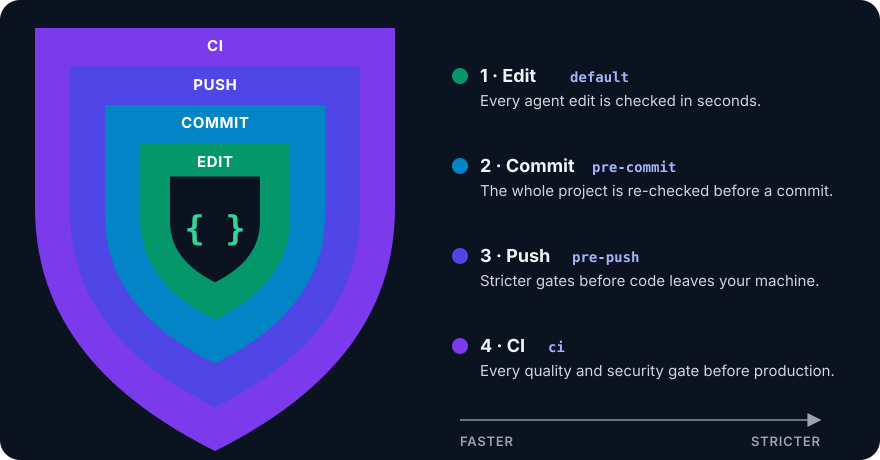
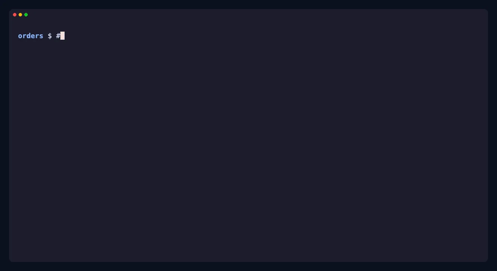

<div align="center">


# Ward

**Quality guardrails for AI coding agents.**
Define your rules once, share them with your team, and every agent follows them, from the first
edit to production.

[](https://github.com/RicardoRB/ward-ai/releases)
[](https://github.com/RicardoRB/ward-ai/actions/workflows/release.yml)
[](https://ricardorb.github.io/ward-ai/)
[](#development)

[](LICENSE)

[Documentation](https://ricardorb.github.io/ward-ai/) ·
[Quick start](#quick-start) ·
[How it works](#how-it-works) ·
[Report a bug](https://github.com/RicardoRB/ward-ai/issues)



</div>

> [!NOTE]
> **Ward is in alpha.** Today it supports **Java projects built with Maven or Gradle**. Support
> for the most widely used languages is planned. The CLI and configuration may change before `1.0`.

## Why Ward?

AI coding agents write code faster than anyone can review it. To keep quality up, you end up
repeating the same rules in every prompt: run the tests, keep methods short, don't add
dependencies, don't break the architecture. That guidance costs tokens and time, and the agent still
forgets.

Ward moves those rules out of your prompts and into your project:

- **The rules live in the repository.** `ward.toml` lists the checks (tests, coverage,
  Checkstyle, PMD, SpotBugs, ArchUnit, security scanners, or any command).
- **Every agent gets the same feedback.** After each edit, Ward runs the fast checks and hands the
  exact failure back to the agent, which fixes it on its own.
- **Stricter checks run later, automatically.** Commit, push, and CI each add more checks, so
  nothing the agent missed reaches production.

You spend less time guiding the agent and fewer tokens on corrections, because the project itself
tells the agent what "good" means.

## How it works

Ward checks your code in four layers. Each layer is a **profile** in `ward.toml`. Inner
layers are fast so they can run constantly; outer layers are stricter.

| Layer | Profile | When it runs | What it's for |
|---|---|---|---|
| **1. Edit** | `default` | After every agent edit, on the edited files | Seconds-fast feedback the agent fixes right away |
| **2. Commit** | `pre-commit` | Git `pre-commit` hook | Re-checks the whole project, in case the agent missed something |
| **3. Push** | `pre-push` | Git `pre-push` hook | Adds compile, tests, coverage, and slower analysis before code leaves your machine |
| **4. CI** | `ci` | Your CI pipeline | Every quality and security gate before production |

Each layer includes the checks of the layers inside it. `ward init` generates this layout for you;
move a check between layers by editing its `profiles` list. Read the
[four quality layers guide](https://ricardorb.github.io/ward-ai/getting-started/how-it-works/).

## Quick start

**1. Install** (Linux and macOS; see [installation](https://ricardorb.github.io/ward-ai/getting-started/installation/) for Windows):

```bash
curl -fsSL https://raw.githubusercontent.com/RicardoRB/ward-ai/main/install.sh | sh
```

**2. Set up your project.** The wizard asks for a preset, the checks, your coding agent, and the Git
hooks:

```bash
cd your-project
ward init
```

Or in one line, for Claude Code with the `standard` preset:

```bash
ward init --preset standard --integration claude-code --quality-hooks
```

**3. Run the checks** yourself, or just let your agent work:

```bash
ward check                     # layer 1: fast checks
ward check --profile pre-push  # layer 3: stricter checks
```

<p align="center">
  
  <br>
  <sub>An agent's change fails PMD, the agent fixes it, and the fast and pre-push checks pass. (<a href=".github/assets/ward-demo.webm">WebM version</a>)</sub>
</p>

Something not working? Run `ward doctor`.

## Let your agent set it up

You don't need to learn every tool's configuration. Ward ships two
[agent skills](https://ricardorb.github.io/ward-ai/integrations/agent-skills/) that set it up
*with* you. They inspect the project, explain each choice, and change files only after you approve.

| Skill | What it does | Try asking |
|---|---|---|
| `ward-init` | Chooses the preset, checks, architecture style, agent integration, and Git hooks for this project, then previews the changes with `ward init --dry-run` | *"Set up Ward quality gates in this project"* |
| `ward-tune` | Fits Checkstyle, PMD, coverage, mutation testing, and ArchUnit rules to your real code. It never weakens a rule without your approval and never adds suppressions | *"Tune the Ward rules to this codebase"* |

```text
/plugin marketplace add RicardoRB/ward-ai    # Claude Code
/plugin install ward@ward-ai
```

```bash
npx skills add RicardoRB/ward-ai --skill ward-init ward-tune   # other agents
```

## Share with your team

Commit the setup and everyone works with the same rules, whatever agent they use:

- `ward.toml`: the checks and which layer runs each one.
- `config/`: the rule files for Checkstyle, PMD, SpotBugs, and the other tools.
- The agent hooks that `ward init` or `ward integrate` generated, such as `.claude/` or
  `.opencode/`.
- `AGENTS.md` (optional, `ward init --agent-rules`): the rules written for agents to read.

Git doesn't share the commit and push hooks through the repository: they live in `.git/hooks/` on
each machine. A one-step setup for teammates is on the [roadmap](#project-status).

In CI, run the outermost layer. The [CI/CD guide](https://ricardorb.github.io/ward-ai/guides/ci-cd/)
has ready-to-copy examples for GitHub Actions, GitLab CI, Jenkins, and more:

```bash
ward check --profile ci --format json > ward-report.json
```

## What it checks

| Category | Tools |
|---|---|
| Build and tests | Compiler, JUnit, JaCoCo coverage, PIT mutation testing |
| Code quality | Checkstyle, PMD, SpotBugs, SonarQube, Spotless |
| Architecture | ArchUnit (Layered, Hexagonal, or Clean), Maven Enforcer / Gradle checks |
| Security | Gitleaks, Semgrep, OWASP Dependency-Check, Trivy, OWASP ZAP |
| Compliance | License plugins, japicmp API compatibility |
| Anything else | Any command you add to `ward.toml` |

Ward runs the tools; the rules live in each tool's own configuration. See
[quality gates](https://ricardorb.github.io/ward-ai/configuration/gates/).

**Coding agents:** Claude Code, OpenCode, Codex, Cursor, GitHub Copilot CLI, Gemini CLI, Windsurf,
Cline, Factory Droid, and Amp. See [integrations](https://ricardorb.github.io/ward-ai/commands/integrate/).

## Documentation

| Topic | Link |
|---|---|
| Getting started | [Installation](https://ricardorb.github.io/ward-ai/getting-started/installation/) · [How it works](https://ricardorb.github.io/ward-ai/getting-started/how-it-works/) · [Quick start](https://ricardorb.github.io/ward-ai/getting-started/quick-start/) |
| Configuration | [`ward.toml`](https://ricardorb.github.io/ward-ai/configuration/ward-toml/) · [Quality gates](https://ricardorb.github.io/ward-ai/configuration/gates/) · [Learning](https://ricardorb.github.io/ward-ai/configuration/learning/) |
| Agents | [Agent skills](https://ricardorb.github.io/ward-ai/integrations/agent-skills/) · [Claude Code](https://ricardorb.github.io/ward-ai/integrations/claude-code/) · [OpenCode](https://ricardorb.github.io/ward-ai/integrations/opencode/) · [Other agents](https://ricardorb.github.io/ward-ai/integrations/native-harnesses/) · [Git hooks](https://ricardorb.github.io/ward-ai/integrations/quality-hooks/) |
| CI/CD | [CI/CD guide](https://ricardorb.github.io/ward-ai/guides/ci-cd/) · [JSON output](https://ricardorb.github.io/ward-ai/reference/json-output/) · [Exit codes](https://ricardorb.github.io/ward-ai/reference/exit-codes/) |
| CLI reference | [`init`](https://ricardorb.github.io/ward-ai/commands/init/) · [`check`](https://ricardorb.github.io/ward-ai/commands/check/) · [`integrate`](https://ricardorb.github.io/ward-ai/commands/integrate/) · [`doctor`](https://ricardorb.github.io/ward-ai/commands/doctor/) · [`loop`](https://ricardorb.github.io/ward-ai/commands/loop/) · [all commands](https://ricardorb.github.io/ward-ai/commands/detect/) |
| Project | [Architecture](https://ricardorb.github.io/ward-ai/architecture/) · [Security](https://ricardorb.github.io/ward-ai/security/) |

## Project status

**Alpha** (`0.1.1`). Runs as a native binary on Linux x86_64, macOS (Apple Silicon and Intel), and
Windows x86_64, or as a JAR on JDK 25. Only the latest release receives fixes.

**Roadmap:**

- Support for the most widely used languages beyond Java
- Shared Git hooks (for example through `core.hooksPath`), so teammates get the commit and push
  layers without a setup step
- More agent skills (`ward-check`, `ward-fix-<gate>`, …)
- Homebrew tap and container image

**Known limitations:** Ward never installs tools; a missing tool is reported as `UNAVAILABLE`.
Commands run without a shell, but that is **not a sandbox** (see below).

## Development

```bash
./mvnw package                                # build target/ward.jar (JDK 25)
./mvnw -Pnative -DskipTests native:compile    # build target/ward (GraalVM 25)
./mvnw -q test                                # run all tests
ward check --profile pre-push             # required before every pull request
```

Contributions are welcome: fork, branch, make sure `ward check --profile pre-push` passes, and
open a pull request. Conventions are in [AGENTS.md](AGENTS.md). Report bugs and request features in
[GitHub Issues](https://github.com/RicardoRB/ward-ai/issues) with your `ward --version` and
`ward doctor` output.

To re-record the demo above, follow the steps at the top of
[`.github/assets/ward-demo.tape`](.github/assets/ward-demo.tape).

## Security

> [!WARNING]
> `ward.toml` is **executable code**. `ward check` and every agent hook run its commands with
> your user's privileges. Do not run Ward on untrusted repositories or pull requests outside a
> sandbox.

Report vulnerabilities privately through
[GitHub Security Advisories](https://github.com/RicardoRB/ward-ai/security/advisories/new), not
in a public issue. Read the full [security model](https://ricardorb.github.io/ward-ai/security/).

## License

[Apache License 2.0](LICENSE). Third-party notices, including the libraries Ward is built on, are
in [`NOTICE`](NOTICE). The quality tools Ward runs are separate projects under their own licenses
and are not bundled.
